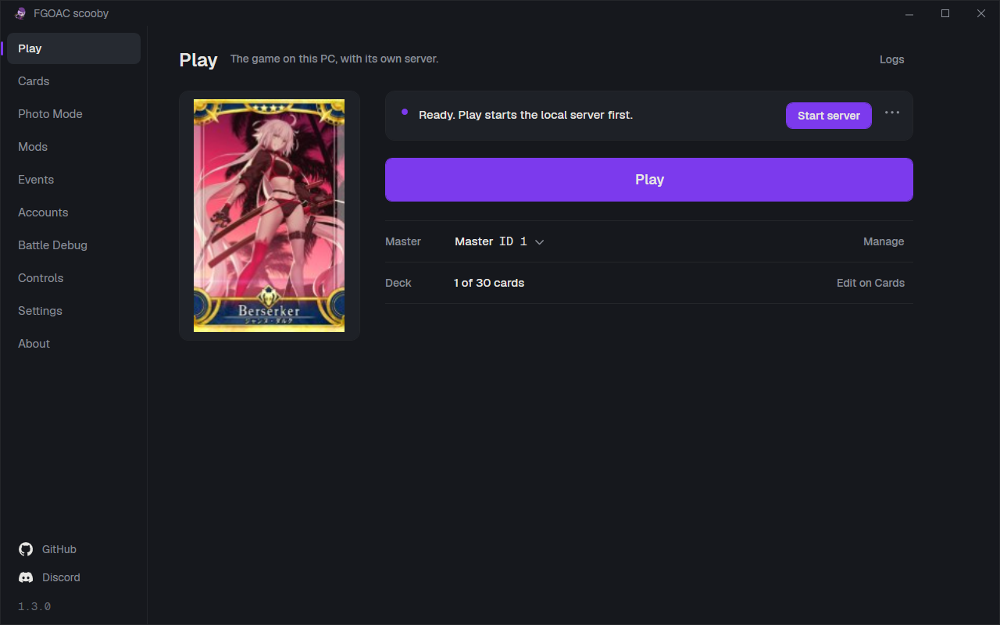
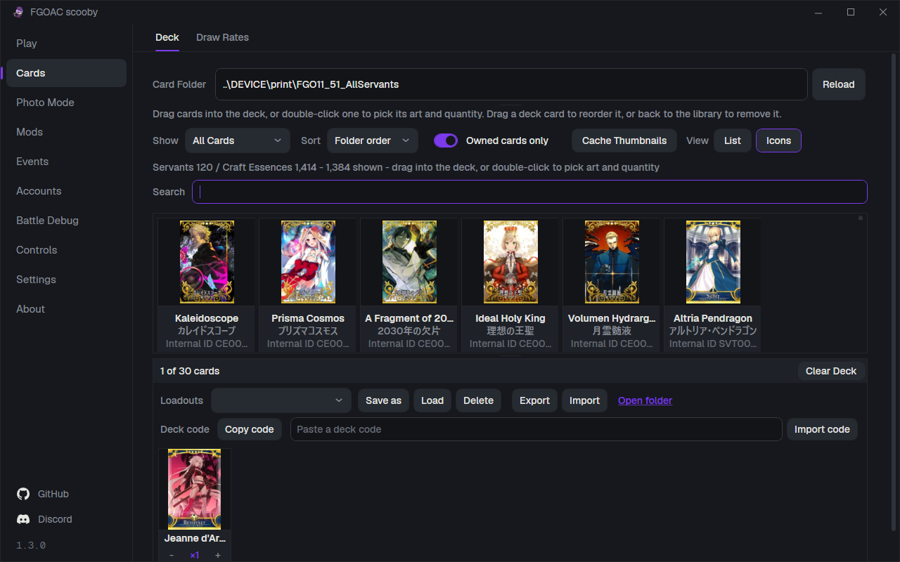
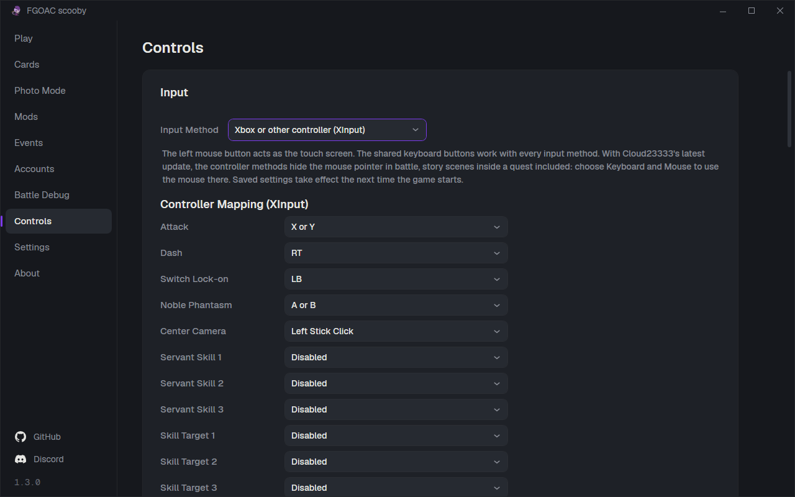
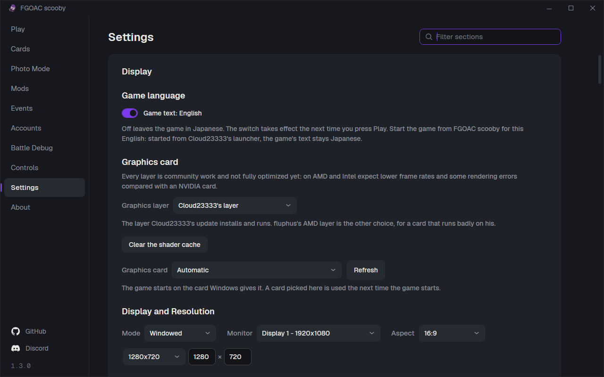

<div align="center">

# FGOAC scooby

**Fate/Grand Order Arcade เป็นภาษาไทย บนพีซีของคุณเอง**

[](https://github.com/felisiach/fgoac-scooby-thaitranslation/releases/latest)
[](https://github.com/felisiach/fgoac-scooby-thaitranslation/releases)
[](LICENSE)
[](https://discord.gg/aNK3KXBQzw)



</div>

FGOAC scooby คือแพตช์ภาษาไทยที่ทำโดยแฟนเกม พร้อมตัวเรียกเกมสำหรับ FGO Arcade local platform
แพตช์นี้แปลตัวเกมเองเป็นภาษาไทย ทั้งเมนู บทเรียนเริ่มต้น เนื้อเรื่อง หน้าจอต่อสู้ ร้านค้า และหน้าช่วยเหลือ
แล้วแทนที่หน้าจอหลักภาษาจีนของแพลตฟอร์มด้วยหน้าจอภาษาไทยที่เริ่มเซิร์ฟเวอร์ในเครื่องให้
จัดการบัญชี Master ของคุณ และประกอบเด็ค 30 ใบจากภาพการ์ดจริง
นี่ไม่ใช่ไฟล์เกมสำหรับดาวน์โหลดและไม่มีไฟล์เกมติดมาด้วย
เพราะจะถูกนำไปวางทับบน FGO Arcade local platform ที่คุณติดตั้งไว้อยู่แล้ว

## สิ่งที่คุณต้องมี

| | |
| --- | --- |
| ตัวเกม | ต้องมี **FGO Arcade local platform V1.01 หรือ V1.02** ติดตั้งอยู่แล้ว (แพ็กเกจของ Cloud23333) คือโฟลเดอร์ที่มี `App` และ `Server` อยู่ ควรใช้ V1.02 เพราะแก้ ERROR 4102 ประวัติเซอร์แวนต์ที่ว่างเปล่า และข้อผิดพลาดการซิงค์หลังจากอัปเกรดเซอร์แวนต์ |
| ระบบปฏิบัติการ | Windows 10 หรือ 11 แบบ 64-bit |
| การ์ดจอ | NVIDIA ที่ใช้ไดรเวอร์รุ่นปัจจุบัน สำหรับ AMD ตัวเรียกเกมจะติดตั้งเลเยอร์ความเข้ากันได้รุ่นเก่าให้เองเมื่อเป็นการติดตั้งใหม่บนเครื่องที่ไม่มีการ์ด NVIDIA เลเยอร์นี้ใช้ได้กับ RX 500, RX 6000, RX 7600 และกราฟิก Ryzen รุ่นเดสก์ท็อป ส่วนเลเยอร์รุ่นใหม่ของ fluphus (การตั้งค่า > การแสดงผล) ใช้ได้กับ RX 7900 XTX แต่บนการ์ดรุ่นอื่นจะหยุดทำงานตอนเข้าการต่อสู้ครั้งแรก กราฟิกออนบอร์ดของ Intel และกราฟิก Ryzen รุ่นโน้ตบุ๊กยังไม่รองรับด้วยเลเยอร์ทั้งสองตัว เลเยอร์ทั้งสองเป็นผลงานของชุมชนและยังปรับแต่งไม่เสร็จสมบูรณ์ ให้คาดหวังอัตราเฟรมที่ต่ำกว่าและข้อผิดพลาดในการแสดงผลบางส่วนเมื่อเทียบกับ NVIDIA หากมีเลเยอร์รุ่นใหม่กว่า สามารถวางไฟล์ลงในโฟลเดอร์ compat แล้วติดตั้งจากการตั้งค่า > การแสดงผลได้ |
| ซีพียู | Intel Core รุ่นที่ 3 (ปี 2012) ขึ้นไป หรือ Ryzen รุ่นใดก็ได้ ชิป Pentium และ Celeron ก่อนรุ่นที่ 12 ไม่มี F16C ซึ่งเป็นชุดคำสั่งที่เกมใช้ และจะหยุดทำงานพร้อม 0xC000001D ตอนเริ่ม |
| ไดรฟ์ | ไดรฟ์ใดก็ได้ **ยกเว้น E: หรือ Y:** ดูตารางด้านล่าง |
| สิทธิ์ | ผู้ดูแลระบบ มีหน้าต่างขออนุญาตของ Windows หนึ่งครั้งตอนตัวเรียกเกมเริ่มทำงาน |

ไม่จำเป็นต้องมี .NET และ Python เพราะตัวเรียกเกมมีรันไทม์ของตัวเองมาด้วย
และแพลตฟอร์มก็มี Python ของตัวเองมาให้

## การติดตั้ง

**คำเตือน:** ภาษาไทยและภาษาอังกฤษใช้ช่อง `App\zh` ช่องเดียวกัน
จึงติดตั้งทั้งสองภาษาพร้อมกันในเวอร์ชันเดียวกันไม่ได้

1. ดาวน์โหลดไฟล์ zip ของรีลีสล่าสุด แล้วแตกไฟล์ลงในโฟลเดอร์ FGO Arcade ของคุณ ข้าง `App` และ `Server`
2. เรียกใช้ **FGOAC scooby.exe** แล้วคลิก **Yes** ในหน้าต่างขออนุญาตของ Windows
3. กด **เล่น (Play)** เกมจะใช้เวลาราวหนึ่งนาทีกว่าจะถึงหน้าจอไตเติล

การเริ่มครั้งแรกจะจัดการส่วนที่เหลือให้เองทั้งหมด คือติดตั้งไฟล์ภาษาไทย ตรวจสอบว่าเกมเขียนลงโฟลเดอร์ของตัวเองได้
อนุญาตให้เกมและเซิร์ฟเวอร์ในเครื่องผ่าน Windows Firewall สร้างบัญชี **Master** พร้อมชุดเซอร์แวนต์และ
Craft Essence ครบทั้งหมด และตั้งการแสดงผลเป็นโหมดหน้าต่าง 1280x720 บนจอหลักของคุณ
การเริ่มครั้งต่อ ๆ ไปจะไปที่หน้าเล่นทันที

ติดตั้งไว้อยู่แล้วใช่ไหม หน้าเล่นจะขึ้นแถบแจ้งเมื่อมีเวอร์ชันใหม่ ปุ่ม **ติดตั้งตอนนี้ (Install now)**
จะดาวน์โหลด ติดตั้ง แล้วเริ่มตัวเรียกเกมใหม่ และมีหน้าต่างเล็ก ๆ บอกว่ามีอะไรเปลี่ยนไปบ้าง
บัญชี เด็ค การตั้งค่า และเลเยอร์กราฟิกของคุณจะคงอยู่เหมือนเดิม
การแตกไฟล์รีลีสใหม่ทับโฟลเดอร์เดิมก็ให้ผลเหมือนกัน

[`docs/GUIDE_TH.md`](docs/GUIDE_TH.md) คือคู่มือผู้เล่นฉบับเต็ม ครอบคลุมวิธีได้เซอร์แวนต์ การควบคุม
การออกรบทีละขั้นตอน ร้านแลกเปลี่ยน และการแก้ปัญหา
ส่วน [`docs/GUIDE_EN.pdf`](docs/GUIDE_EN.pdf) คือคู่มือฉบับภาษาอังกฤษ

## สิ่งที่ใช้งานได้

- **ข้อความในเกม** - แปลแล้ว 65,266 บรรทัด ทั้งเนื้อเรื่อง เควสต์ ประวัติเซอร์แวนต์และ Craft Essence
  สกิล ไอเทม ภารกิจ และทุกเมนู ชื่อต่าง ๆ อ้างอิงตามฉบับภาษาอังกฤษ
- **งานภาพในเกม** - คลังสไปรต์ที่สร้างใหม่ 240 ชุด ทั้งหน้าไตเติล บทเรียนเริ่มต้น เทอร์มินัล การจัดทีม
  HUD การต่อสู้ หน้าผลลัพธ์ ร้านค้า การสังเคราะห์ กล่องของขวัญ ภารกิจมาสเตอร์ อันดับ หน้าช่วยเหลือ
  และตัวแก้ไขไตเติล
- **เล่นคนเดียวแบบออฟไลน์ได้ครบวงจร** - ทั้งบทเรียนเริ่มต้น การออกรบเดี่ยว เทอร์มินัล ร้านแลกเปลี่ยน
  การสังเคราะห์ My Room อันดับ และตัวแก้ไขไตเติล
- **ตัวเรียกเกม** ครบทั้งห้าหน้า พร้อมชื่อการ์ดภาษาอังกฤษอย่างเป็นทางการและเอฟเฟกต์ของ Craft Essence
- **การซัมมอนในเกม** - สุ่มจากพูลของเซิร์ฟเวอร์ในเครื่องตามน้ำหนักที่ตั้งไว้ในหน้าอัตราการสุ่ม
  คุณไม่จำเป็นต้องพึ่งมันเพื่อให้ได้การ์ดครบ เพราะหน้าบัญชีมอบให้ครบได้ในคลิกเดียว
  และคลังการ์ดมีการ์ดครบทั้ง 1,384 ใบ
- **ชุดเด็คและพรีเซ็ตอัตราการสุ่ม** - บันทึก โหลด และลบได้ไม่จำกัดจำนวนจากหน้าการ์ดและเด็ค
  และหน้าอัตราการสุ่ม พร้อมส่งออกและนำเข้าเพื่อส่งให้ผู้เล่นคนอื่นเป็นไฟล์เล็ก ๆ

## สิ่งที่ยังใช้งานไม่ได้

- **ไม่มีการเล่นออนไลน์** ทุกอย่างทำงานกับเซิร์ฟเวอร์ในเครื่อง ไม่มีการจับคู่ผู้เล่น
  และไม่มีบริการอย่างเป็นทางการให้เชื่อมต่ออีกแล้ว
- **ยังไม่รองรับกราฟิก Intel** กราฟิกออนบอร์ดของ Intel (Iris Xe) และ Intel Arc หยุดทำงานกับเลเยอร์
  ความเข้ากันได้ทั้งสองตัว เช่นเดียวกับกราฟิก Ryzen รุ่นโน้ตบุ๊ก กำลังหาทางแก้อยู่
  จนกว่าจะแก้ได้ เกมต้องใช้การ์ด NVIDIA หรือการ์ด AMD ที่ระบุไว้ในหัวข้อสิ่งที่คุณต้องมี
- **หน้าจออีเวนต์บางหน้ายังเป็นภาษาญี่ปุ่น** ได้แก่ แบนเนอร์อีเวนต์ co-op หน้าจอผลลัพธ์ co-op
  และร้านค้าอีเวนต์รุ่นหลัง ๆ ทั้งหมดเป็นงานภาพ ไม่ใช่ข้อความ และไม่กระทบส่วนอื่นเลย

## ตัวเรียกเกม

| หน้า | หน้าที่ |
| --- | --- |
| **Play** | Play and Stop Game on the server on this PC, the Status sentence with the next step beside it (Start server, Stop server, Install, What's new), Manage beside the Master line for the accounts page, open the logs, Save a report in the Status menu, and live readouts for the server, the selected Master and the deck. The page to leave open while the game runs. |
| **Accounts** | Also opened with Manage beside the Master line on Play. The selected local account's details, its summon results, and create, select and delete Master accounts, and grant one of them a full Servant, Craft Essence and item roster in a single click, with levels, bond, costumes and clear rewards. With Cloud23333's latest update, Export all and Import move every local account through one file, the one his launcher uses. |
| **Cards** | Deck and Draw Rates. The card library and the deck editor, searchable by official English name, with Craft Essence effects in FGO NA phrasing. Each deck card has - and + for its copies and Remove all copies; each saved loadout has a button above the deck that loads it. Copy code and Import code share the deck as one line of text. The deck is sent to the game every time you press Play. |
| **Photo Mode** | The photo mode panel: free camera, depth of field, expressions, poses and the Servant model, live while the game runs. |
| **Mods** | The MOD folder of Cloud23333's latest update, App\1_MOD. |
| **Events** | Which limited-time events the server on this PC offers: with Cloud23333's latest update his event switches, grouped by edition and kind and in an order of your own; on the earlier game the Banners patch. |
| **Battle Debug** | Battle test switches for local play, including Stop the battle timer. |
| **Controls** | Input - keyboard, an Xbox or other controller (XInput) or a PlayStation 5 controller (DualSense), with dead zone, rumble, a controller test and the Operator menu keys (F1, F2) switch for ERROR 8404; with Cloud23333's latest update also his keyboard battle mode with its mouse camera, his controller camera, card selection with the controller, his controller mouse, and a switch that keeps the mouse inside the game window. Bindings - a key, controller button or chord that taps a button on the game's screen. Cursor - size, outline, position and the mouse button that taps the screen (Tap with). |
| **Settings** | Display - monitor, resolution, aspect ratio, frame rate, display mode, a graphics card pick, the Graphics layer for AMD and Intel graphics (Cloud23333's layer by default, the 1.1.0 layer or fluphus's AMD layer), and Widescreen: the picture fitted to screens that are not 16:9, with the full width kept on 16:10 and 4:3, and the HUD and menus at the screen edges (being tried, off by default); with Cloud23333's latest update also fog, reflections, draw distance, ultra-low quality and the treasure chests' size and opacity. Battle effects - hide the dark or white screen during Noble Phantasms, hide the white screen flash, and an Effect opacity slider for how strongly the game's own battle effects are drawn. Audio. PC play - the continue window and popups wait for you instead of counting down; three more switches, off until tried in the game, remove the GP purchase screen, make story pages wait for a press, and remove the menu countdown. Local server - the local server and its settings. Diagnostics and Help with every game error code and its fix. The box at the top filters the sections. |
| **About** | The version, Check for updates, the links to GitHub and Discord, and the credits. |

### Everyday use

- **Play.** Play plays on the server on this PC. The Status sentence says where things stand -
  whether the local server is running - or, in one sentence, why Play cannot start yet.
- **The Master menu.** Click the Master line on Play: it lists your local accounts to switch between,
  with New account at the bottom; Manage beside the line opens the accounts page.
- **Deck codes.** Copy code on Cards puts the deck on the clipboard as one line of text to paste in
  chat. Paste a code into the box beside it and press Import code: the deck loads and is saved as a
  new loadout, never over one you have.
- **Save a report.** Open the Status menu, the button at the end of the Status line on Play, and
  choose Save a report. It saves one zip, on the Desktop unless you pick another place, with your
  card number taken out. Nothing is uploaded: you attach the file yourself.
- **Bindings.** Controls > Bindings ties a key, a controller button or a combination such as Ctrl+F5
  to a button on the game's screen: click a box and press what you want.
- **Camera.** With Cloud23333's latest update the camera is his, set on Controls: Battles
  in free camera, his keyboard battle mode, turns the view with the mouse in battle, and Controller
  camera turns it with the right stick, with a lock-on button. Keep the mouse inside the game window,
  also on Controls, holds the pointer in the window while the game is in front. Changes count from
  the next Play.
- **PC play.** Settings > PC play: after a lost quest Continue and Withdraw wait for you, and popups
  stay open until you answer them; both are on. No GP purchase screen, Story pages wait for you and
  No menu countdown are off until they have been tried in the game; turn them on to try them.
  Changes count from the next Play.
- **Widescreen.** Settings > Display > Widescreen: Widescreen picture fits the picture to screens
  that are not 16:9, and Full width on taller screens keeps the whole width on 16:10 and 4:3; both
  are on. HUD and menus at the screen edges is off while it is being tried.
- **Logs.** Logs on Play opens the drawer, which shows one log at a time: Launcher, Game or
  Server.
  It remembers your choice.

ตัวเรียกเกมอัปเดตตัวเองได้ โดยถาม GitHub Releases ว่ามีเวอร์ชันใหม่กว่าหรือไม่
แล้วเสนอที่จะดาวน์โหลดและติดตั้งให้ การแก้คำแปลจึงถึงมือคุณได้โดยไม่ต้องติดตั้งใหม่

<p align="center">
  
  
  
</p>

## ถ้ามีอะไรผิดพลาด

Open **Settings > Diagnostics and Help** first. It lists every game error code with the fix, and the
answer is usually there.

| อาการที่เห็น | สาเหตุ | สิ่งที่ต้องทำ |
| --- | --- | --- |
| **ERROR 4102** | เกมติดต่อเซิร์ฟเวอร์ในเครื่องไม่ได้ บน V1.01 ยังเกิดขึ้นเมื่อชื่อเครื่องตรงกับชื่อผู้ใช้ด้วย | เริ่มเซิร์ฟเวอร์จากหน้าเล่น รอจนกว่าจะรายงานว่าพร้อม แล้วกดเล่นอีกครั้ง ถ้ายังเกิดซ้ำบน V1.01 ให้อัปเดตเป็น V1.02 ของ Cloud23333 ซึ่งแก้ปัญหานี้แล้ว |
| **ERROR 8404** ตอนบูต | Startup Mode ของตัวเกมเองถูกบันทึกไว้เป็น Satellite (Sub Unit) เกมจึงรอเครื่องหลักที่ไม่มีอยู่จริง | ที่หน้าจอข้อผิดพลาดให้กด **F1** เพื่อเข้า Game Test Menu (**F2** เลื่อนลูกศร **F1** ยืนยัน) เปิด **Game Settings** ตั้ง **Startup Mode** เป็น **Main Unit** แล้วเลือก **Exit** การบูตครั้งถัดไปจะถึงหน้าไตเติล |
| **Cannot use Aime card** ที่หน้าจอไตเติล | ข้อความแรกที่เกมส่งไปยังเซิร์ฟเวอร์ในเครื่องหมดเวลาในการบูตครั้งนั้น | ปิดเกม ตรวจว่าเซิร์ฟเวอร์ขึ้นว่าพร้อมในหน้าเล่น แล้วกดเล่นอีกครั้ง |
| **0x80131515** ตอนกดเล่น หรือเซิร์ฟเวอร์หยุดพร้อมข้อความเกี่ยวกับ `FGO_Runtime.dll` | Windows ทำเครื่องหมายว่า `App\FGO_Runtime.dll` ถูกดาวน์โหลดมาจากอินเทอร์เน็ต และ PowerShell ปฏิเสธที่จะโหลดไฟล์ที่มีเครื่องหมายนั้น | ตัวเรียกเกมจะล้างเครื่องหมายนี้ให้เอง ถ้ายังกลับมาอีก ให้คลิกขวาที่ไฟล์ เปิด Properties แล้วติ๊ก **Unblock** |
| **"ไฟล์บางไฟล์ที่เกมต้องใช้หายไป"** ตอนตัวเรียกเกมเริ่มทำงาน | ไฟล์ zip ถูกแตกไว้ที่อื่นที่ไม่ใช่โฟลเดอร์เกม หรือโฟลเดอร์นั้นไม่เคยได้รับอัปเดต V1.01 ของ Cloud23333 | แตกไฟล์ลงในโฟลเดอร์ที่มี `App` และ `Server` อยู่ ให้ `FGOAC scooby.exe` วางอยู่ข้างกัน และติดตั้ง V1.01 หรือ V1.02 ก่อน |
| **หน้าต่างเกมเปิดขึ้นแล้วปิดไปเอง** (exit code 22) ทั้งที่การตรวจสอบสภาพแวดล้อมผ่าน | ยังระบุสาเหตุไม่ได้ | ลองใช้โหมดหน้าต่าง 1280x720 บนจอหลัก เวลารายงานปัญหา ให้แนบ `logs\ago-crash-*.dmp` และบอกรุ่นการ์ดจอกับเวอร์ชันไดรเวอร์ของคุณ |
| **"Update failed" ตอนท้ายของตัวอัปเดต V1.02 ของ Cloud23333** หลังจากที่มันขึ้นว่าติดตั้งไฟล์แพตช์แล้ว | ไฟล์ของเขาลงครบแล้ว มีเพียงขั้นตอนสุดท้ายที่หยุดไป คือการกู้คืนเซอร์แวนต์ที่อัปเกรดไว้ก่อน V1.02 เพราะสภาพแวดล้อม Python ที่เขาแถมมาชี้ไปยังโฟลเดอร์ที่มีอยู่เฉพาะบนเครื่องของเขา | ใช้ FGOAC scooby ตามปกติ ถ้าคุณเคยอัปเกรดเซอร์แวนต์ไว้ก่อน V1.02 และอยากกู้คืน ให้รันคำสั่งนี้หนึ่งครั้งจากโฟลเดอร์เกม: `Server\python\python.exe Server\tools\repair_fgo_grail.py --logs logs --report logs\grail-recovery.json --apply` |
| **ERROR 4104** | ติดตั้งอยู่บนไดรฟ์ **E:** หรือ **Y:** ฮุกไฟล์ของตัวเกมเองส่งทุกพาธบนไดรฟ์เหล่านั้นไปยังจุดเชื่อมข้อมูลของตู้ เกมจึงเปิดไฟล์ของตัวเองไม่ได้ | ย้ายทั้งโฟลเดอร์เกมไปไว้ที่ไดรฟ์อื่น |
| **ERROR 4105** ราวเก้าสิบวินาทีหลังเปิดเกม | เกมไม่ได้ถูกเรียกใช้ในฐานะผู้ดูแลระบบ | คลิก **Yes** ในหน้าต่างขออนุญาตของ Windows ตอนตัวเรียกเกมเริ่มทำงาน |
| **0xC0000005** ไม่กี่วินาทีหลังเปิดเกม | Windows Defender **Controlled Folder Access** กำลังบล็อกไม่ให้เกมเขียนไฟล์ของตัวเอง | อนุญาตโฟลเดอร์เกมหรือ `App\ago.exe` ใน Windows Security > Virus and threat protection > Ransomware protection |
| **จอดำตอนเปิดเกม** | เกือบทุกครั้งเป็นเรื่องไดรเวอร์ NVIDIA ไม่ใช่ตัวแพตช์ | อัปเดตไดรเวอร์แล้วลองใหม่ |
| **เกมค้างที่จอดำในการเปิดครั้งแรกสุด** | มีหน้าต่างถามของ Windows Firewall รออยู่หลังหน้าต่างเกม ปกติตัวเรียกเกมสร้างกฎเหล่านั้นให้เอง แต่นโยบายขององค์กรหรือชุดโปรแกรมความปลอดภัยอาจขัดขวางได้ | มองหาหน้าต่างนั้นในแถบงาน แล้วอนุญาตทั้ง `Server\python\python.exe` และ `App\ago.exe` |
| **เมนูหลักทำงานผิดปกติทันทีหลังจบบทเรียนเริ่มต้น** | เป็นอาการที่ทราบกันดีของช่วงส่งต่อจากบทเรียนไปยังเมนูหลัก | เริ่มเกมใหม่หนึ่งครั้ง |
| **เกมหยุดทำงานตอนโหลดการต่อสู้ครั้งแรกบนการ์ด AMD** exit code 22 | เลเยอร์รุ่นใหม่สร้างเชเดอร์ของเกมบนการ์ดใบนั้นไม่สำเร็จ | ไปที่ การตั้งค่า > การแสดงผล > ย้อนกลับไปใช้เลเยอร์รุ่นเก่า แล้วกดเล่น |
| **exit code 22 พร้อม 0xC000001D** ทันทีหลังเริ่ม | ซีพียูไม่มี F16C | แก้ไม่ได้บนซีพียูตัวนั้น |
| **ERROR 6401** ตอนเริ่ม เมื่อต่อคอนโทรลเลอร์หรืออุปกรณ์ USB | ยังระบุสาเหตุไม่ได้ | ผู้เล่นรายงานว่าอาการหายไปเมื่อปิด USB selective suspend ของ Windows (Power Options > Change plan settings > Change advanced power settings > USB settings) |
| **ตัวเรียกเกมบอกว่าโฟลเดอร์นี้ไม่เคยได้รับ V1.01** หรือบอกว่า fgohook.dll ยังเป็น 11.00 | อัปเดต V1.01 ของ Cloud23333 ไม่เคยถูกติดตั้ง หรือติดตั้งค้างกลางคัน | แตกไฟล์ V1.02 ของ Cloud23333 ทับโฟลเดอร์เกมและปล่อยให้เขียนทับ แล้วเปิดตัวเรียกเกมอีกครั้ง |
| **ไม่มีการ์ดเลยหลังการเริ่มครั้งแรก**, ERROR 0949 หรือ ERROR 0087 เมื่อเกมอยู่บนไดรฟ์แบบ Storage Spaces หรือ ReFS | ไฟล์ RAR บางส่วนแตกไม่สำเร็จ หรือไดรฟ์ปฏิเสธการเขียนเซฟของเกม | แตกไฟล์เกมหลักใหม่และปล่อยให้เขียนทับ และเก็บการติดตั้งไว้บนไดรฟ์ NTFS ธรรมดา |
| **Google Drive เปลี่ยนชื่อไฟล์ RAR** (เป็น part1-003 และอื่น ๆ) | Google Drive เปลี่ยนชื่อไฟล์ที่ดาวน์โหลดพร้อมกันแทนที่จะคงหมายเลขส่วนเดิมไว้ | เปลี่ยนชื่อกลับเป็น FGOA_Cloud23333.part1.rar, part2.rar ... และแตกไฟล์ zip เล็กเพื่อให้ได้ part5.rar ก่อนจะแตก part1 |
| **ลิงก์ดาวน์โหลดจาก 123 Pan** | ไม่ใช่ของ Cloud23333 | ใช้เฉพาะลิงก์ในคำอธิบาย Bilibili ของเขาเท่านั้น |

เวลารายงานปัญหา ให้เปิด issue แล้วบอกว่าคุณอยู่ที่หน้าจอไหนและคาดหวังอะไร แนบเท่าที่คุณมีจากโฟลเดอร์
`logs` ที่อยู่ข้าง `App` ได้แก่ `fgo-last-launch.log`, `fgozh.log`, `server-control.log`,
`artemis-stderr.log`, `mariadb.log` และ `environment-check.txt` ซึ่งหน้าการวินิจฉัยและความช่วยเหลือ
เขียนให้คุณเอง

## การคอมไพล์จากซอร์ส

คุณต้องมี .NET SDK (รุ่นที่ใช้พัฒนาคือ 10.x) และ Windows 10 หรือ 11 x64 ส่วนที่เหลือทั้งหมด
ทั้ง reference และ runtime pack ของ .NET 6 กับแพ็กเกจที่ต้องพึ่งพาอีกหนึ่งตัว
จะถูกดึงมาจาก nuget.org ตอนคอมไพล์ครั้งแรก

```
build.cmd                     compile check only
publish.cmd                   self-contained single file, into dist\
deploy.cmd <install root>     copy the published launcher into an install
```

`publish.cmd` จะเขียน `dist\FGOAC scooby.exe` ออกมา และควรได้คำเตือนศูนย์รายการ ข้อผิดพลาดศูนย์รายการ

[`docs/DEVELOPING.md`](docs/DEVELOPING.md) อธิบายว่า `src\` มาจากไหน การแก้ที่ผลการดีคอมไพล์ต้องใช้
เพื่อให้คอมไพล์ผ่าน สิ่งที่งานแปลห้ามเปลี่ยนเด็ดขาด และวิธีสร้างบิลด์ขึ้นใหม่เมื่อผู้เขียนออกเวอร์ชันใหม่
ส่วน [`CONTRIBUTING.md`](CONTRIBUTING.md) เป็นแนวทางการเขียนของโครงการ

## การออกรีลีส

รีลีสหนึ่งชุดคือไฟล์ zip หนึ่งไฟล์ ที่สร้างจากรีโพนี้กับไฟล์เกมภาษาไทยในเครื่องที่ติดตั้งไว้
พร้อมแมนิเฟสต์ SHA-256 ที่สร้างจากไบต์ชุดเดียวกับที่ส่งออกไป ตัวอัปเดตในตัวเรียกเกมอ่าน
`releases/latest` ดังนั้นรีลีสจะถึงมือผู้เล่นก็ต่อเมื่อเผยแพร่แล้วและไม่ได้ทำเครื่องหมายเป็น pre-release

```
publish.cmd
package.ps1 -GameRoot <install root> -AddOnDll <build folder>\fgoacaddon.dll
```

That writes `release\FGOAC-scooby-vX.Y.Z.zip` and `FGOAC-scooby-vX.Y.Z.zip.sha256`. Sign the zip
with `tools\Sign-Release.ps1`, which writes `FGOAC-scooby-vX.Y.Z.zip.sig` beside it. Tag the commit
`vX.Y.Z`, publish a GitHub release on that tag, and upload all three files as assets. The updater
takes the zip only under the exact name its tag gives and needs its `.zip.sig`: one or more
signature lines, of which one has to verify under the release keys built into the launcher, or
nothing is installed. The `.zip.sha256` is only for launchers 1.2.0 and older, which check the zip
against it.

## เครดิต

**Cloud23333** เป็นผู้เขียน FGO Arcade local platform ทั้งแพ็กเกจเซิร์ฟเวอร์ หน้าจอหลัก
(`FGOLocalPlatform`) ที่ FGOAC scooby สร้างต่อยอดมา และฮุกไฟล์ที่แพตช์นี้ใช้โหลดภาษาไทยเข้าไป
ทั้งหมดนี้เกิดขึ้นไม่ได้เลยหากไม่มีผลงานชิ้นนั้น และแพ็กเกจของเขาแจกฟรี ถ้ามีใครขายให้คุณ ให้ทวงเงินคืน **FGO Arcade wiki** และ **Atlas Academy** คือที่มาของชื่อภาษาอังกฤษ
อย่างเป็นทางการของเซอร์แวนต์ Craft Essence สกิล และไอเทม เกมและตัวเรียกเกมจึงเรียกทุกอย่าง
ตามที่ฉบับภาษาอังกฤษเรียก **fluphus** เป็นผู้เขียนเลเยอร์ความเข้ากันได้สำหรับ AMD และ Intel ชื่อ
[fgo-arcade-amd-shim](https://github.com/fluphus/fgo-arcade-amd-shim) ซึ่งแถมมาในโฟลเดอร์
`compat\amd-shim` พร้อมสัญญาอนุญาต MIT ของมัน **Fate/Grand Order Arcade เป็นของ Sega และ
TYPE-MOON** ซึ่งเป็นเจ้าของเกม นี่คืองานแปลโดยแฟนเกมที่นำไปใช้กับไฟล์ที่คุณมีอยู่แล้ว ไม่มีการจำหน่าย
และไม่มีไฟล์เกมติดมาด้วยแต่อย่างใด

เผยแพร่ภายใต้[สัญญาอนุญาต MIT](LICENSE)
